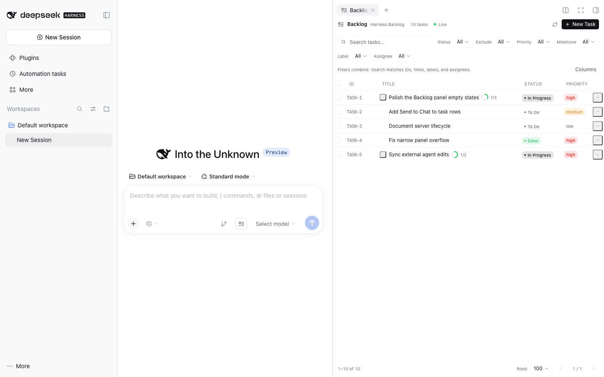
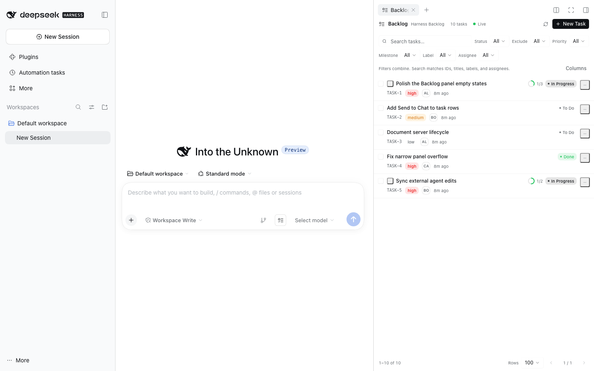
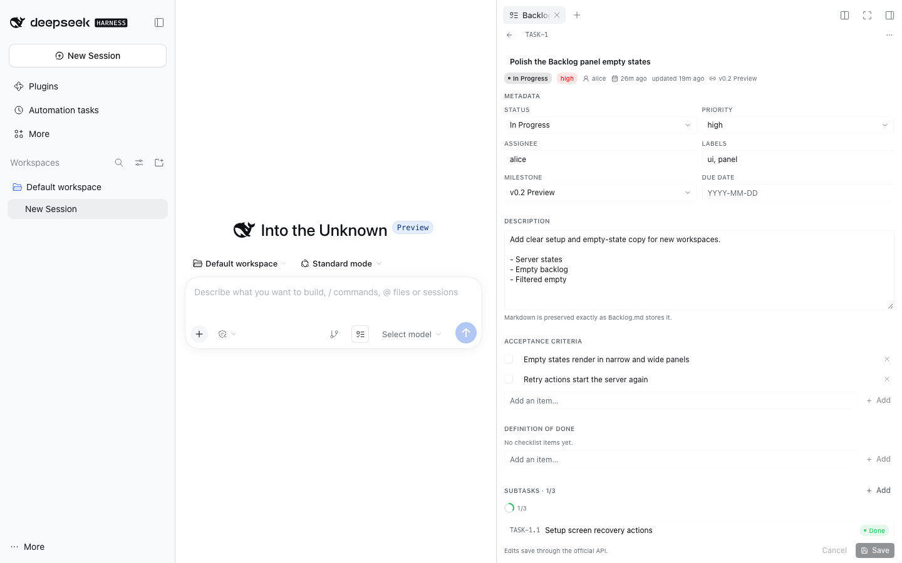
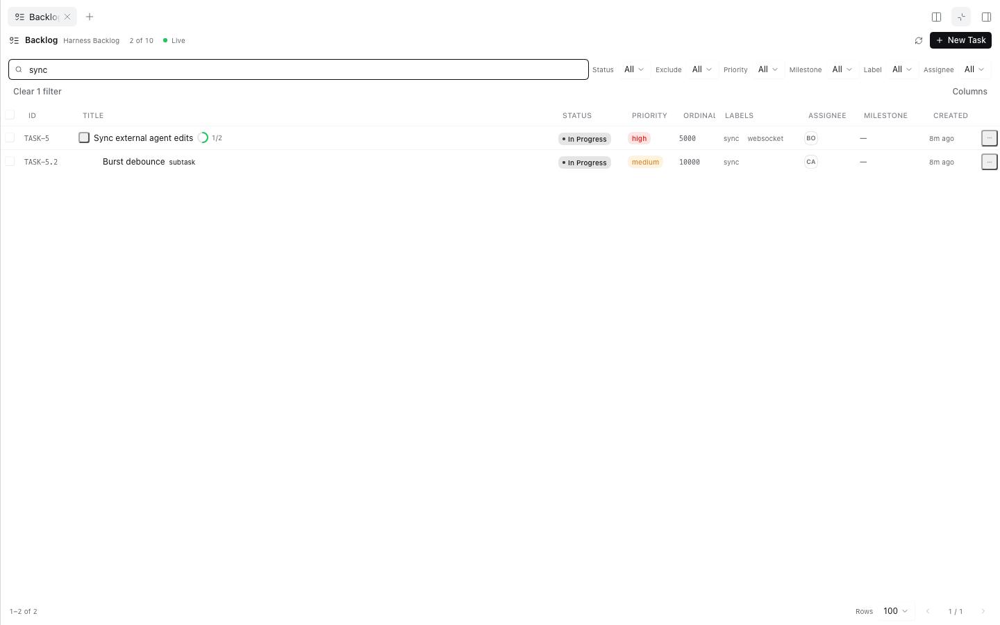

# Backlog.md for DeepSeek Harness

Native [Backlog.md](https://github.com/MrLesk/Backlog.md) task management inside
[DeepSeek Harness](https://deepseek-harness.github.io/deepseek-harness/). The plugin adds a
**Backlog** launcher beside Source Control, renders the task view in Harness's native right-side
panel, and starts and manages the official Backlog.md local server for the active workspace.

Backlog.md remains the single source of truth. The plugin never creates a second task database and
never writes task Markdown itself.



## Features

- **Native launcher** — a `ListTodo` button beside Source Control, with the same dimensions, hover
  treatment, tooltip, focus ring, and panel-toggle behaviour. It highlights while Backlog is active.
- **Native right-side panel** — registered as a sidebar tab type, so it uses Harness's resizing,
  collapse, fullscreen, focus, and per-session persistence. The chat and agent session stay mounted.
- **Zero server setup** — detects the workspace's Backlog.md project, finds the installed CLI,
  allocates a loopback port, starts `backlog browser` when needed, waits for health, and connects.
  Users never run `backlog browser` by hand.
- **Safe reuse and ownership** — one managed server per canonical workspace; multiple Harness
  sessions share it. A server the plugin did not start is never terminated.
- **Official API only** — task and milestone reads and writes go through Backlog.md's HTTP API.
- **Live synchronization** — the Host subscribes to Backlog.md's WebSocket notifications and relays
  change scopes to the panel, which invalidates TanStack Query caches. No duplicate filesystem
  watcher.
- **Wide table and compact list** — one TanStack Table instance drives both presentations. CSS
  container queries switch at the panel's real content width, never the viewport. Filtering,
  sorting, selection, expansion, and detail navigation survive the switch.
- **Full task workflows** — create, edit, change status or priority, assign, label, milestone,
  dependencies, acceptance criteria, Definition of Done, subtasks, archive, and permanent delete.
- **Conflict-aware editing** — unsaved edits survive background refreshes; external changes are
  detected before saving, with explicit reload or merge choices. No silent overwrites.
- **Send to Chat** — puts a ready-to-edit prompt into the current Harness composer. It never sends
  the message automatically.
- **Agent-friendly** — changes made by the Backlog.md CLI, MCP server, Codex, or another editor
  appear through the same WebSocket notifications. No agent-side plugin integration is required.

## Screenshots

| Full table | Narrow panel |
| --- | --- |
|  |  |

| Task details | Filtered table |
| --- | --- |
|  |  |

The launcher sits directly beside Source Control in the composer:


## Requirements

| Component | Supported |
| --- | --- |
| DeepSeek Harness | `0.2.1-rc.3` tested. The plugin uses the public Cordis lifecycle, `slots`, `locale`, `sidebarRightTabs`, `sidebarRight`, `webServer`, `subprocess`, `sessions`, and `workingDirectory` services. |
| Backlog.md | `1.55.3` tested; `1.54.0` also verified in the Harness UI. Supported range: `>=1.30.0 <2.0.0`. |
| Node | 22 or newer on the Host. The shipped plugin has no runtime npm dependencies. |
| OS | macOS, Linux, and Windows where Backlog.md's native CLI runs. |

Backlog.md must be installed **in the workspace** (`node_modules/.bin/backlog`) or available on
`PATH`. A workspace-local install wins. An initialized Backlog.md project is required; the panel
shows the exact `backlog init` commands when it is missing.

## Install

### Desktop app (recommended)

1. Open **Settings → Plugins**.
2. Choose **Add plugin** and enter the local directory path (or the GitHub repository).
3. Make sure the plugin is enabled, then reload the page or restart the Host.

The desktop profile is managed by the Electron application, so the Settings flow is the supported
installation path there.

### CLI

Clone the repository and add it to a profile:

```bash
git clone https://github.com/jeremytenjo/dsh-plugin-backlog-md.git
dsh plugin --profile <profile> add ./dsh-plugin-backlog-md
```

A GitHub spec also works:

```bash
dsh plugin --profile <profile> add github:jeremytenjo/dsh-plugin-backlog-md
```

Use the profile that serves your Harness instance (for example `web`). The package ships its built
`client.js`, so installation does not need a build step.

### First run

1. Install Backlog.md in the workspace or on `PATH`:

   ```bash
   npm install --save-dev backlog.md
   # or: pnpm add -D backlog.md
   # or: npm install -g backlog.md
   ```

2. Initialize the project once, if it is not already:

   ```bash
   backlog init
   # or non-interactive defaults:
   backlog init --defaults
   ```

3. Open a Harness session in that workspace and click **Backlog** beside Source Control.

The panel starts the server itself. No `backlog browser` command is needed.

## Usage

### Launcher and panel

The Backlog button is registered in the composer's `conversation.input.right` slot at order `11`,
immediately after the Source Control trigger (order `10`). Clicking it opens the `backlog-md` tab in
the native right sidebar. Clicking again when Backlog is active follows Harness's native panel
toggle. The panel is registered with `keepMounted: true`, so closing and reopening it preserves its
state.

### Filters

Search, Status, Exclude status, Priority, Milestone, Labels, and Assignee combine without reloads.
The filtered count appears in the header; **Clear filters** resets everything. Filter, sorting,
column visibility, and page size are persisted per workspace in `localStorage`; no task data is
stored there.

### Wide table

Columns: ID, Title (with subtask progress), Status, Priority, Ordinal, Labels, Assignee, Milestone,
Created, and row actions. The table has sticky headers, compact rows, hover and focus states,
column sorting, row selection, expandable subtasks, and configurable column visibility. At narrower
panel widths, fixed-layout columns leave the DOM and become available again as the container grows.

### Compact list

Below the panel container's 600px breakpoint, the compact list shows the title, ID, subtask
progress, status, priority, assignee, and relative creation time. It never requires horizontal
scroll. Both presentations read the same TanStack Table instance, so switching widths keeps the
same filter, sort, selection, expansion, pagination, and detail handlers.

### Task details

Clicking a row drills into details inside the same panel. The header has a back button, task ID,
editable title, and actions. Metadata includes status, priority, assignee, labels, milestone, parent
task, dependency links, created and updated dates, and the server ownership/source. Content includes
the Markdown description source, acceptance criteria, Definition of Done checklist, subtasks, and
dependencies. Comments are shown read-only.

The footer shows unsaved state and provides Save/Cancel. The detail view:

- keeps local edits through background refetches;
- detects external changes before saving;
- offers **Reload latest** or **Merge my edits** with a per-field explanation;
- never silently overwrites an external change;
- confirms archive and permanent deletion.

### Send to Chat

The row menu and detail menu include **Send to Chat**. It identifies the current Harness session,
builds a prompt such as:

```text
Implement TASK-20.4 "Wire real-time sync" using its Backlog.md task definition. Follow AGENTS.md,
update task status as work progresses, and verify all acceptance criteria.
```

and calls the official composer `inputActions.setDraft(...)`. It does not submit. The full prompt is
visible and editable before the user sends it.

### External agent changes

A coding agent can keep using the Backlog.md CLI or MCP server normally:

1. The CLI edits the Markdown file.
2. Backlog.md's `ContentStore` detects the change.
3. The Backlog.md server broadcasts a WebSocket notification.
4. The Host relay receives it and exposes the change scope to the panel.
5. TanStack Query invalidates the affected task, milestone, task-detail, or config queries.
6. The panel refetches and rerenders.

Rapid bursts are debounced. A reconnect requests a full resync so missed events are recovered.

## Architecture

```text
┌──────────────────────────── DeepSeek Harness ────────────────────────────┐
│                                                                          │
│  React panel (client.js)                  Host plugin (index.js)         │
│  ┌────────────────────────┐   same-origin  ┌──────────────────────────┐  │
│  │ BacklogPanel           │   POST /__dsh/ │ BacklogBridge            │  │
│  │  TanStack Query        │   backlog-md   │  session → workspace     │  │
│  │  TanStack Table        │ ─────────────► │  fixed action allowlist  │  │
│  │  shadcn/ui + Tailwind  │ ◄───────────── │  typed validation        │  │
│  └────────────────────────┘   JSON + long  └──────────┬───────────────┘  │
│             │                       poll              │                  │
│             │                                         ▼                  │
│             │                              ┌──────────────────────────┐  │
│             │                              │ BacklogServerManager     │  │
│             │                              │  one record per realpath │  │
│             │                              │  port allocation         │  │
│             │                              │  health + version gate   │  │
│             │                              │  crash budget + cleanup  │  │
│             │                              └──────────┬───────────────┘  │
│             │                                         │ spawn            │
│             │                                         ▼                  │
│             │                              ┌──────────────────────────┐  │
│             │                              │ backlog browser          │  │
│             │                              │ 127.0.0.1:<dynamic port> │  │
│             │                              └──────────┬───────────────┘  │
│             │                                         │                  │
│             │         WebSocket notifications         │                  │
│             │                              ┌──────────▼───────────────┐  │
│             └──────────────────────────────│ BacklogEventHub          │  │
│                                            │ ring buffer + long poll  │  │
│                                            └──────────────────────────┘  │
└──────────────────────────────────────────────────────────────────────────┘

                    Backlog.md Markdown files (single source of truth)
```

### Host-side workspace resolution

The browser never sends a filesystem path. It sends the active Harness session ID. The Host resolves
the Session with `ctx.sessions.get`, then the working directory with
`ctx.workingDirectory.get`, canonicalizes it with `realpath`, and walks up to the nearest
Backlog.md project (`backlog/config.yml`, `.backlog/config.yml`, `backlog.config.yml`, or
`backlog.json`). The canonical project root is the server-ownership identity.

### `BacklogServerManager`

- Allocates a free loopback port with `net` and starts the official CLI:

  ```text
  backlog browser --port <port> --no-open
  ```

- If the CLI selects a different port because of a race, the manager parses the URL it prints and
  uses the actual port.
- Probes `GET /api/status` and `GET /api/version` until healthy, validating the reported
  `projectPath` against the canonical workspace and the version against the supported range.
- Reuses a healthy managed server. Concurrent calls share a single in-flight start.
- Checks the project's configured `default_port` for an already-running compatible server and adopts
  it with `owned: false` when its project identity and version match. It is never terminated.
- Tracks crashes with a bounded restart budget, removes dead records, and lets the next panel request
  start a fresh server.
- Binds servers to `127.0.0.1` only. Dynamic ports are never exposed to the browser.
- Stops only owned processes on plugin disposal and idle cleanup (30 minutes by default).

### HTTP bridge

One exact route, `POST /__dsh/backlog-md`, is the plugin's only browser-facing surface. It:

- accepts only `POST` with `application/json`;
- requires a loopback socket and the Harness origin (`ctx.webServer.getOrigin()`), and rejects
  `Sec-Fetch-Site: cross-site`;
- limits request bodies to 512 KiB and responses to 16 MiB;
- resolves the workspace from the Session, never from the request;
- exposes a fixed action set (`status`, `tasks.list`, `tasks.get`, `tasks.create`, `tasks.update`,
  `tasks.archive`, `tasks.delete`, `tasks.reorder`, `milestones.list`, `milestones.create`,
  `search`, `server.restart`, `events`);
- validates task IDs, arrays, lengths, and types at the trust boundary;
- strips `filePath` and `rawContent` from task responses and `mcp`, `onStatusChange`, and other
  command-bearing configuration from `/api/config`.

`events` is a long poll (12 second waiting window) over the Host's WebSocket relay. This keeps the
browser on one same-origin, validated transport and works through Harness's Electron fetch bridge.

### API surface used

| Purpose | Official endpoint |
| --- | --- |
| Project identity / health | `GET /api/status` |
| Version gate | `GET /api/version` |
| Configuration | `GET /api/config` |
| Statuses | `GET /api/statuses` |
| List tasks | `GET /api/tasks` |
| Task detail + dependency graph | `GET /api/task/:id` |
| Create task / subtask | `POST /api/tasks` |
| Update task | `PUT /api/tasks/:id` |
| Archive task | `POST /api/tasks/:id/archive` |
| Reorder task | `POST /api/tasks/reorder` |
| Milestones | `GET /api/milestones`, `POST /api/milestones` |
| Search | `GET /api/search` |

Backlog.md has no HTTP hard-delete endpoint. **Delete permanently** archives through the official API,
then invokes the official CLI (`backlog task delete <id>`) with an argv array and no shell. The
default destructive action is **Archive**, which preserves the Markdown record, ID, and links.

### Real-time relay

`BacklogEventHub` owns one WebSocket client per managed server. It understands the messages the
current server publishes: `tasks-updated`, `milestones-updated`, `config-updated`, `loaded`,
loading-state JSON, and `pong`. Events are stored in a 200-entry ring with monotonic sequence
numbers. A cursor older than the ring returns `resync`, and every reconnect also requests a full
resync. Waiters are bounded by timeout and cancellation. The React hook debounces invalidation by
150 ms, reconnects with bounded exponential backoff (1 s to 15 s), and refetches all affected caches
after a gap.

### Why the browser never talks to Backlog.md directly

The Backlog.md server is a powerful local HTTP service with no built-in authorization. Exposing its
port to the page would make it reachable from any local script or browser origin and would bypass
Harness's session authorization. The bridge keeps the server on loopback and gives the browser only
the actions the panel needs, for the workspace belonging to the active Harness session.

## Development

```bash
pnpm install
pnpm typecheck   # TypeScript, tests included
pnpm lint        # Biome
pnpm test        # 21 client tests + 20 host tests (real Backlog.md CLI)
pnpm build       # regenerates client.js (Tailwind + esbuild bundle)
pnpm verify      # lint, typecheck, test, build
```

`src/client.tsx` is the browser entry. `src/server/**` is the Host half. `client.js` is generated and
committed; update it with `pnpm build` whenever client source changes.

The host integration tests install and exercise the pinned `backlog.md` dev dependency. They create
temporary projects, start real servers on dynamic ports, test reuse/adoption/crash recovery/port
conflicts/workspace isolation, exercise every mutation, verify the WebSocket relay, and confirm the
loopback and origin fences. Tests were executed with DeepSeek Harness `0.2.1-rc.3` and Backlog.md
`1.55.3` on macOS.

### Layout

```text
index.js                     Host plugin entry: route + manager lifecycle
src/server/                  workspace, CLI, API client, manager, event hub, bridge
src/client.tsx               Cordis client registration
src/client/components/       panel, table, list, details, dialogs, shadcn/ui primitives
src/client/hooks/            TanStack Query hooks, connection relay, persisted UI state
src/client/api/bridge.ts     typed bridge client
src/client/lib/              task tree, filters, formatting, utilities
test/                        client (Vitest) and host (node:test) suites
docs/                        screenshots
```

## Security summary

- Managed servers bind only `127.0.0.1`; no public API exposure.
- Browser actions use one same-origin, loopback-only Host route.
- The request never supplies a workspace path, server URL, executable, or command.
- Process execution uses argv arrays, never a shell. Task IDs are validated before the one CLI call.
- Response bodies and task IDs are bounded; malformed responses fail closed.
- Configuration is sanitized; MCP tokens and command fields never reach the browser.
- Unknown task metadata is preserved by the API mutations (the plugin sends only changed fields).
- Presentation state is the only localStorage data; there is no task cache database.

## Troubleshooting

| Panel state | Action |
| --- | --- |
| **Backlog.md is not installed** | Install `backlog.md` in the workspace or on `PATH`, then press Retry. |
| **Initialize Backlog.md** | Run `backlog init` in the workspace, then press Retry. |
| **Backlog.md needs an update** | Install a 1.x release at or above `1.30.0`. |
| **Backlog.md is unavailable / crashed** | Press Retry or Restart server. Retry also resets the crash budget. |
| Server starts but tasks never sync | Check that the workspace is the intended project and that no firewall blocks loopback. Reopen the panel to force a resync. |
| A port is occupied | The manager lets the CLI choose the next free port automatically. |

## Compatibility notes

- Backlog.md `1.54.0` returns naive `YYYY-MM-DD HH:mm` timestamps from some HTTP endpoints; the UI
  parses those as UTC. ISO timestamps with `Z` are handled normally.
- Backlog.md `1.55.3` is the pinned test version. The manager refuses 2.x and versions older than
  `1.30.0` with an actionable error.
- The plugin does not publish to npm. Install from a local checkout or GitHub.
- A compatible manually started server is reused only when it listens on the project's configured
  `default_port` and reports the same canonical `projectPath` and a supported version. Arbitrary
  ports are not scanned.

## Known limitations

- **Markdown is preserved, not parsed.** Descriptions are displayed and edited as Markdown source in
  a monospace textarea. The plugin deliberately does not add a second Markdown parser. Renderers
  elsewhere in Harness still own rich rendering.
- **Permanent delete needs the CLI.** Backlog.md exposes archive, not hard delete, over HTTP. The
  permanent delete action is therefore archive plus the official `backlog task delete` CLI; it can
  refuse a task that still has subtasks or links, and the panel reports that refusal.
- **External server discovery is bounded.** The manager can verify an existing server only on the
  project's configured default port. Servers on arbitrary ports are not probed.
- **One Host, one manager.** Servers are shared across sessions in the same Harness Host. Separate
  DSH processes each manage their own server; the plugin does not coordinate across processes.
- **Agent activity is not inferred.** The panel shows task state. It does not claim an agent is
  working on a task merely because its status is In Progress.
- **Send to Chat depends on the composer.** It uses the official `inputActions.setDraft` when the
  panel receives it, with a launcher event fallback. If the composer is unavailable, the panel reports
  that it could not reach it.

## License

MIT. See [LICENSE](LICENSE).

Backlog.md is a separate MIT-licensed project by Alex Gavrilescu. This plugin is an independent
integration and is not affiliated with the Backlog.md maintainers.
